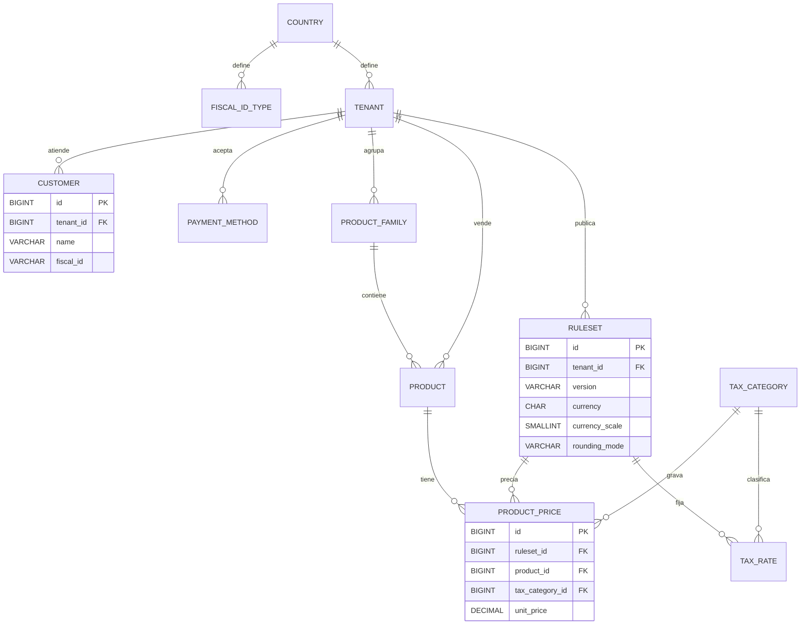
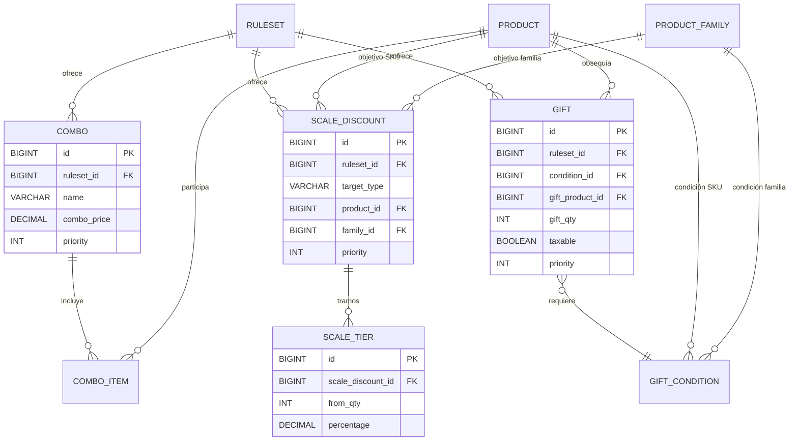
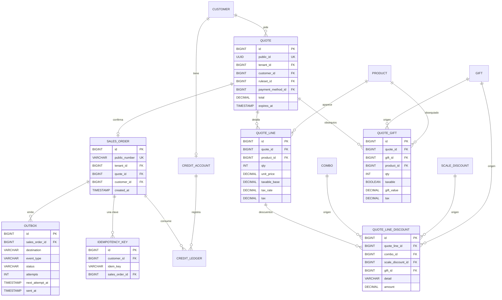

# ADR — Flujo de pedidos B2B multi-tenant

**Estado:** aceptado · **Fecha:** 2026-10-19

El cuerpo (secciones 1 a 5) concentra las decisiones. Los anexos contienen los DER y ejemplos reales de request/response.

## 1. Contexto

Opero un marketplace B2B donde tenderos compran a distribuidores de bebidas. La plataforma es multi-tenant (varias marcas comerciales y varios países sobre el mismo sistema) y el flujo del pedido es catálogo → carrito → checkout (cotización) → confirmación → historial. Sobre el precio conviven palancas —descuento por escala, combo y obsequio— más los impuestos y el cupo de crédito.

El ejercicio pone el foco en dos invariantes:

1. **El total cotizado y el total confirmado no pueden divergir**, aunque cambien precios o palancas entre ambos momentos.
2. **La confirmación es idempotente y atómica**: si responde 201 con número de orden, el pedido existe, es consultable y el cupo se consumió una vez; los reintentos y el doble tap no duplican ni consumen dos veces.

Implementé ese tramo completo en Java 21 con Spring Boot WebFlux, JDBC y Flyway sobre H2 en memoria (modo PostgreSQL). No implementé catálogo, carrito ni historial más allá de la consulta del pedido.

## 2. Decisiones

### D1 — Stack: WebFlux, JDBC explícito, Flyway y H2

Elegí WebFlux porque el enunciado lo propone y el trabajo es I/O-bound. Usé JDBC en lugar de JPA para que el SQL, los índices y las constraints queden a la vista: son parte del diseño de las invariantes, no un detalle del ORM. Flyway versiona el esquema y el seed, y H2 en memoria permite correr todo con un comando, sin infraestructura para el evaluador.

**Descarté:** JPA (oculta el SQL y las constraints); un Postgres real (más fiel, pero agrega infraestructura y no cambia las decisiones); Go o NestJS (no aportaban al objetivo).

### D2 — Multi-tenant por fila, aislamiento en los datos

Cada tabla de negocio lleva `tenant_id` y toda lectura se filtra por tenant. La cotización y el pedido referencian al cliente y entre sí con **FKs compuestas** `(tenant_id, id)`, de modo que una referencia entre marcas es imposible a nivel base, no solo por convención en el código.

**Descarté:** un schema por tenant (mejor aislamiento, pero multiplica migraciones y operación); confiar solo en la capa de aplicación (un `findById` olvidado filtra datos de otra marca).

### D3 — Orden y prioridades de las palancas

Armo una **lista única de palancas aplicables** y la ordeno por **prioridad descendente**. Cada palanca aplicada **consume** las unidades que descuenta, y una unidad consumida no vuelve a participar en otra palanca. Ese consumo es el mecanismo que impide el doble descuento.

Con las prioridades del seed (combo 20, escala 10, obsequio 5) el orden efectivo es **combo → escala → obsequio → impuesto**. A igual prioridad desempato de forma fija: **tipo** (combo, escala, obsequio) → **objetivo** (SKU antes que familia, porque es más específico) → **id mayor** (la palanca más nueva). Nunca elijo la palanca que minimiza el total.

Por qué ese orden:

- **Combo primero**: tiene un precio propio para un conjunto concreto de unidades. Si corriera después de la escala, las mismas unidades recibirían dos descuentos.
- **Escala después**: descuenta un porcentaje sobre las unidades que el combo no consumió, y así ambas palancas pueden coexistir sin solaparse.
- **Obsequio después**: sus condiciones se evalúan sobre el **carrito bruto** (unidades y valor de lista, antes de descuentos), y agrega unidades que no participan de combo ni escala; de ese modo el regalo no "paga" descuentos.
- **Impuesto al final**: se calcula sobre la base gravable después de los descuentos comerciales, como define el dominio.

**Descarté:** un optimizador que minimice el total del comprador (impredecible, difícil de explicar y de soportar, y cambia resultados ante cada palanca nueva); ordenar por inserción (no determinista entre entornos); dejar convivir palancas sobre las mismas unidades (doble descuento).

### D4 — Combo: prioridad y mínimo como piso

Entre los combos aplicables gana el de mayor prioridad. Las cantidades mínimas se cobran al precio de combo y las unidades por encima del mínimo se pagan a precio regular.

**Descarté:** elegir el combo que más ahorra (mejor para el comprador, pero impredecible y no configurable por el distribuidor).

### D5 — Escala: el tramo alcanzado aplica a todas las unidades

Los tramos son acumulativos por cantidad de inicio. Se aplica el porcentaje del mayor `from_qty` alcanzado a **todas** las unidades del objetivo. Una escala de SKU gana a una de familia a igual prioridad, y la de familia suma las unidades de sus productos.

**Descarté:** porcentaje progresivo por tramo (más "justo", pero más difícil de explicar y no era lo pedido); permitir que SKU y familia descuenten las mismas unidades (doble descuento).

### D6 — Obsequio: condición sobre el bruto, línea marcada y descuento

Si se cumple la condición —cantidad de un producto o familia, monto mínimo, o ambos con AND—, agrego una línea del producto obsequiado **marcada como regalo** y un descuento `GIFT` por su valor, de modo que el producto no se paga. Todas las condiciones cumplidas acumulan. Un obsequio gravable se grava sobre su valor bruto (su base queda en cero); uno no gravable no paga impuesto. Persisto el obsequio en `quote_gift`, no como línea pagada, para que un regalo de un producto ya comprado no choque con `UNIQUE (quote_id, product_id)`.

**Descarté:** una lista de obsequios separada del desglose por línea (rompía el requisito de ver el regalo con su cantidad); gravar el obsequio sobre la base cero (perdía el impuesto que el dominio exige).

### D7 — Dinero exacto, multi-país y redondeo por línea

Uso `BigDecimal` en todo el código, `DECIMAL(19,4)` para importes y `DECIMAL(7,4)` para tasas; nunca `double`. La moneda, su escala decimal y el modo de redondeo salen del `ruleset` del tenant, no están en el código: el seed usa GTQ escala 2 y COP escala 0, ambos HALF_UP. Redondeo la **base gravable y el impuesto de cada línea** a la escala de la moneda con el modo del ruleset, y el total es la suma de las líneas ya redondeadas. Encapsulé la aritmética en un value object `Money` para que el redondeo no se pueda olvidar.

**Descarté:** redondear solo el total (las líneas no cierran contra el total y el desglose queda inconsistente); `double` (errores de representación inaceptables para dinero).

### D8 — Cotización inmutable: el mecanismo que impide la divergencia

Al cotizar congelo el ruleset, los precios, las tasas, las líneas, los descuentos y el total en `quote`, `quote_line`, `quote_line_discount` y `quote_gift`. La confirmación **no vuelve a cotizar**: lee la cotización y usa su total. Por eso el total cotizado y el confirmado son el mismo número por construcción, aunque cambien precios o palancas entre ambos momentos. La orden queda ligada a su cotización con `UNIQUE (quote_id)`, y la cotización expira a las 24 horas.

**Descarté:** re-cotizar al confirmar con el ruleset vigente (es exactamente el bug que describe el enunciado); guardar solo el total y reconstruir las líneas (se pierde la trazabilidad del desglose).

### D9 — Cupo de crédito: preview sin lock, consumo con lock

En el cálculo indico si el pedido cabe en el cupo con un bloque `creditFit` (`fits`, `available`, `total`, `reason`): `FITS`, `INSUFFICIENT_CREDIT` o `NO_ACCOUNT`. Se calcula sobre el **total final** (después de palancas e impuestos) y solo cuando el medio de pago usa crédito; con un medio que no usa crédito el bloque es `null`. La lectura del preview es **sin lock** porque es una foto, y la confirmación **vuelve a verificar con lock** sobre la cuenta y consume en la misma transacción; si no alcanza, rechaza con 422 y no crea la orden. Un cliente sin cuenta recibe `NO_ACCOUNT` con `fits: false` y `available: 0` en el preview, y la confirmación es la que rechaza.

**Descarté:** confiar en el `creditFit` del preview para confirmar (entre la cotización y la confirmación el cupo puede cambiar); bloquear la cuenta durante todo el checkout (contiene al usuario y no aporta: la verificación final con lock es la que vale).

### D10 — Confirmación idempotente y atómica

`POST /orders` recibe la **clave de idempotencia** y solo la referencia pública de la cotización; el cliente no manda montos. En **una transacción** escribo la orden, la clave, el movimiento de cupo y los eventos de outbox, y recién después del commit respondo **201**. La invariante "201 con número ⇒ la orden existe, es consultable y el cupo se consumió una vez" se apoya en tres cosas: la transacción, `UNIQUE (quote_id)` (una orden por cotización) y `UNIQUE (customer_id, idem_key)` (una clave, una orden).

La semántica es: misma clave + misma cotización → **201 con la misma orden** (`replayed: true`), sin repetir efectos; cotización ya confirmada con otra clave → **409 `QUOTE_ALREADY_CONFIRMED`**; clave usada en otra cotización → **409 `IDEMPOTENCY_CONFLICT`**. Si dos requests simultáneos compiten, el que pierde el insert relee al ganador y devuelve el mismo 201: un pedido, un consumo.

**Descarté:** fallar el reintento (rompe el caso de red inestable que la clave existe para resolver y contradice "el reintento devuelve el mismo resultado"); devolver 200 en el replay (mismo resultado con dos códigos, contrato más difícil de consumir).

### D11 — Outbox transaccional para los efectos externos

La confirmación escribe dos filas `PENDING` en la misma transacción que la orden: destino **PUSH** (notificación al tendero vía FCM, APNs o Web Push) y destino **ERP** (publicación del pedido). "Push" acá es el aviso al dispositivo del tendero, no una llamada al ERP.

Garantías:

- **No se pierden**: si la transacción commitea, los eventos quedan; si el proceso muere, el relay los retoma. Si la transacción falla, no queda ni orden ni evento.
- **No se duplican al confirmar**: el reintento no crea orden ni eventos, y `UNIQUE (sales_order_id, destination, event_type)` lo impide.
- **No se duplican al entregar**: el outbox es **at-least-once**; el consumidor deduplica por el id del evento o por el número de pedido. El relay reclamará filas con `FOR UPDATE SKIP LOCKED` y las marcará `SENT` en la misma transacción.
- **Si el sistema externo está caído**: la confirmación ya respondió 201 y no depende de él; el evento queda `PENDING`, sube `attempts`, guarda `last_error` y agenda `next_attempt_at` con backoff exponencial. Si supera el máximo de intentos pasa a `FAILED` para replay manual. El pedido nunca se revierte ni se bloquea por un push o un ERP caído.

**Qué sacrifico:** tengo consistencia fuerte dentro de la transacción (orden, cupo, clave y eventos) y **entrega al menos una vez** hacia afuera: no hay exactly-once ni orden garantizado entre eventos, y el consumidor deduplica por el id del evento. La cotización, en cambio, es consistente por inmutabilidad y no por coordinación entre servicios.

**Decisión de alcance:** el esquema y la escritura transaccional del outbox están; el **relay no está implementado** (las filas se guardan con `payload` vacío). Lo dejé fuera conscientemente, ver §3.

**Descarté:** llamar a los sistemas externos dentro de la transacción (si el externo está lento o caído, se cae la confirmación o se duplica al reintentar); publicar directo a un broker (agrega infraestructura que el ejercicio no pide).

### D12 — Errores claros, sin filtrar, y consultas siempre por tenant

Los errores devuelven `code`, `message` y `details`, nunca ids internos, SQL ni stack traces. Todas las lecturas por id son tenant-scoped; un recurso de otra marca responde **404**, no 403, para no revelar existencia. La consulta del pedido es `GET /orders/{number}` con el tenant en el header.

### D13 — Sin cache

No agregué Redis ni cache en memoria. No estaba pedido, el dataset es chico, hay una sola instancia y el riesgo de invalidación —un precio o ruleset nuevo sirviendo datos viejos— es mayor que el beneficio. La consistencia entre cotización y confirmación ya está resuelta por la inmutabilidad de la cotización, no por cache. Si el volumen lo justificara, cachearía el `ruleset` **por versión** (inmutable) y mediría antes de optimizar.

### D14 — Sin autenticación ni autorización

No implementé login, tokens, roles ni Spring Security: está fuera del alcance del ejercicio. Hoy el tenant viaja en `X-Tenant-Id` y se confía en él; el aislamiento que sí garantizo es **a nivel de datos** (filtros tenant-scoped y FKs compuestas). En producción el tenant se derivaría del token, se autorizaría quién puede confirmar la cotización de quién y se sumarían rate limiting y auditoría. Queda declarado como límite conocido: el servicio no debe exponerse públicamente tal cual.

### D15 — Cobertura de pruebas

Los tests fijan las garantías, no solo los caminos felices: dos tramos de escala, combo sin descuento suelto, obsequio visible con su cantidad, combo con impuesto, cupo excedido, regresión cotizo → confirmo con totales idénticos, replay de la misma clave, doble tap concurrente, cotización vencida, aislamiento entre tenants y un pedido que conserva su precio después de cambiar precios.

## 3. Qué no implementé conscientemente

| No implementado | Por qué |
|---|---|
| Cache (Redis o memoria) | No estaba pedido; dataset chico; la invalidación agrega más riesgo que beneficio (D13). |
| Autenticación y autorización | Fuera de alcance del ejercicio; el aislamiento es de datos, no de identidad (D14). |
| Relay del outbox | El ejercicio pide explicar la garantía y demostrarla en tests; el esquema, la escritura transaccional, el backoff y el dead-letter están modelados, la entrega queda como siguiente paso (D11). |
| Front Angular/Flutter | Opcional y no suma al objetivo; preferí invertir el tiempo en las invariantes del backend. |
| Catálogo, carrito e historial completos | El foco era pricing, cotización y confirmación; el carrito entra como request y el historial se resuelve con `GET /orders/{number}`. |
| Multi-instancia y particionado | No hacen falta para demostrar las invariantes; el diseño no los impide (claves y constraints globales). |

## 4. Qué revisaría en un code review de este código

- **Aislamiento multi-tenant**: que toda consulta filtre por tenant, que ningún id del body pueda cruzar de marca y que las FKs compuestas estén donde importan.
- **Límites transaccionales**: cotización y confirmación en una sola transacción, sin llamadas externas adentro, y el 201 emitido solo después del commit.
- **Idempotencia**: constraints únicos, semántica del replay, los dos 409 y la resolución de la carrera (releer al ganador, no reintentar el efecto).
- **Dinero**: cero `double`, escala de la moneda tomada del ruleset, redondeo por línea y total como suma de líneas redondeadas.
- **Determinismo del pricing**: comparador estable, consumo de unidades, obsequio sobre el bruto y ausencia de doble descuento.
- **Base de datos**: constraints e índices de FKs, precisión de `DECIMAL`, migraciones ordenadas y compatibles con el seed.
- **API**: errores que no filtren internos, validación de entrada y que el cliente no pueda mandar montos.
- **Tests**: que cubran invariantes (concurrencia, replay, aislamiento, cambio de precio) y no solo el camino feliz.

## 5. Riesgo principal y mitigación

**Riesgo:** el pipeline determinista puede elegir una combinación más cara para el comprador que la óptima global; un competidor podría cotizar distinto y el tendero notarlo. Además, explicar por qué ganó una palanca exige entender las prioridades.

**Mitigación:** las prioridades son configuración del distribuidor por ruleset, no código; los tests dorados fijan el resultado esperado por escenario; el desglose expone el origen de cada descuento, por línea y por palanca, para que la decisión sea auditable. Si el negocio pidiera optimización, la haría como una estrategia explícita y versionada, comparando contra el resultado actual con un reporte de diferencias, en lugar de cambiar el comportamiento por defecto.

## 6. Cómo correrlo

Un solo comando para tests: `gradlew.bat clean test` (Windows) o `./gradlew clean test`. Para levantar el servicio: `gradlew.bat bootRun`; escucha en `:8080` y aplica las migraciones Flyway contra H2 en memoria. El README detalla los comandos y los endpoints.

## Anexo A — DER de las entidades principales

### A.1 Tenancy, impuestos, productos y precios



### A.2 Palancas



### A.3 Cotización, pedido y efectos



## Anexo B — Ejemplos

### B.1 Pricing — `POST /api/v1/pricing`

Carrito: GAS-500 ×6 y AGU-500 ×6 (seed de Bebidas GT; aplica el combo `Gaseosa + Agua x6` a 20000).

```json
{
  "tenantId": 1,
  "customerId": 1,
  "paymentMethodId": 1,
  "lines": [
    { "productId": 1, "qty": 6 },
    { "productId": 2, "qty": 6 }
  ]
}
```

```json
{
  "tenantId": 1,
  "rulesetId": 1,
  "currency": "GTQ",
  "lines": [
    { "productId": 1, "qty": 6, "unitPrice": 4000.0000, "gross": 24000.00, "discount": 11692.31,
      "taxableBase": 12307.69, "taxRate": 12.0000, "tax": 1476.92, "gift": false },
    { "productId": 2, "qty": 6, "unitPrice": 2500.0000, "gross": 15000.00, "discount": 7307.69,
      "taxableBase": 7692.31, "taxRate": 12.0000, "tax": 923.08, "gift": false }
  ],
  "discounts": [
    { "productId": 1, "origin": "COMBO", "sourceId": 1, "detail": "Gaseosa + Agua x6", "amount": 11692.31 },
    { "productId": 2, "origin": "COMBO", "sourceId": 1, "detail": "Gaseosa + Agua x6", "amount": 7307.69 }
  ],
  "grossSubtotal": 39000.00,
  "totalDiscounts": 19000.00,
  "totalTaxableBase": 20000.00,
  "totalTax": 2400.00,
  "total": 22400.00,
  "creditFit": { "fits": true, "available": 300000.00, "total": 22400.00, "reason": "FITS" }
}
```

### B.2 Cotización — `POST /api/v1/quotes`

Mismo carrito. Responde 201 con la referencia pública y el vencimiento a 24 horas.

```json
{
  "publicId": "8f14e45f-ceea-4b4a-9f0e-2d6c1f7a1b23",
  "expiresAt": "2026-10-20T10:00:00Z",
  "breakdown": { "...": "mismo shape que POST /pricing" }
}
```

### B.3 Confirmación — `POST /api/v1/orders`

```bash
curl -i -X POST http://localhost:8080/api/v1/orders \
  -H "Content-Type: application/json" \
  -H "X-Tenant-Id: 1" \
  -H "Idempotency-Key: 7d3f9a1e-2c4b-4e6d-9a8f-1b2c3d4e5f60" \
  -d '{ "quotePublicId": "8f14e45f-ceea-4b4a-9f0e-2d6c1f7a1b23" }'
```

```json
{ "number": "5c2f1d6a-9b8e-4a7c-8f1d-2e3b4c5d6e7f", "total": 22400.00, "replayed": false }
```

Reintento con la misma clave y cotización: mismo 201 y mismo `number`, con `"replayed": true`; no crea otra orden ni vuelve a consumir cupo.

### B.4 Consulta — `GET /api/v1/orders/{number}` (header `X-Tenant-Id: 1`)

```json
{
  "number": "5c2f1d6a-9b8e-4a7c-8f1d-2e3b4c5d6e7f",
  "quotePublicId": "8f14e45f-ceea-4b4a-9f0e-2d6c1f7a1b23",
  "total": 22400.00,
  "createdAt": "2026-10-19T10:00:00Z",
  "lines": [
    { "id": 12, "quoteId": 7, "productId": 1, "qty": 6, "unitPrice": 4000.0000,
      "taxableBase": 12307.6900, "taxRate": 12.0000, "tax": 1476.9200 },
    { "id": 13, "quoteId": 7, "productId": 2, "qty": 6, "unitPrice": 2500.0000,
      "taxableBase": 7692.3100, "taxRate": 12.0000, "tax": 923.0800 }
  ]
}
```

Otro tenant con el mismo número recibe 404.

### B.5 Errores

| Caso | Respuesta |
|---|---|
| Clave usada en otra cotización | `409 {"code":"IDEMPOTENCY_CONFLICT","message":"La clave de idempotencia ya se usó para otra cotización.","details":{}}` |
| Cotización ya confirmada con otra clave | `409 {"code":"QUOTE_ALREADY_CONFIRMED","message":"La cotización ya tiene un pedido confirmado.","details":{}}` |
| Cotización inexistente o de otro tenant | `404 {"code":"QUOTE_NOT_FOUND","message":"La cotización no existe o no pertenece a esta tienda.","details":{}}` |
| Cupo insuficiente | `422 {"code":"INSUFFICIENT_CREDIT","message":"El cupo disponible no alcanza para confirmar el pedido.","details":{}}` |
| Cotización vencida | `422 {"code":"QUOTE_EXPIRED","message":"La cotización venció. Volvé a cotizar.","details":{}}` |
| Falta header o body inválido | `400 {"code":"INVALID_REQUEST","message":"La solicitud no es válida.","details":{}}` |
