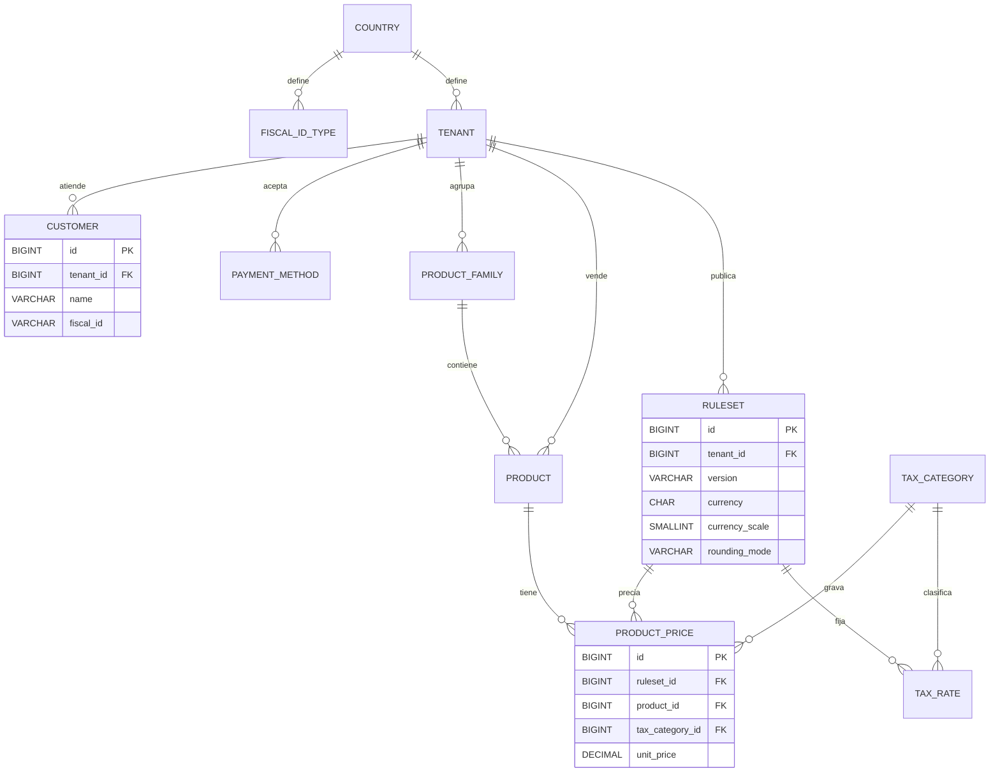
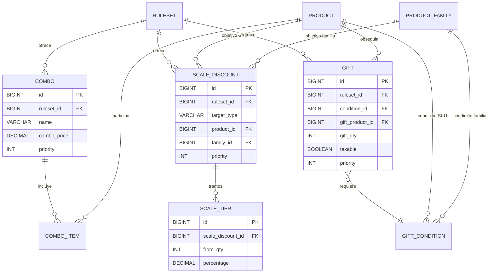
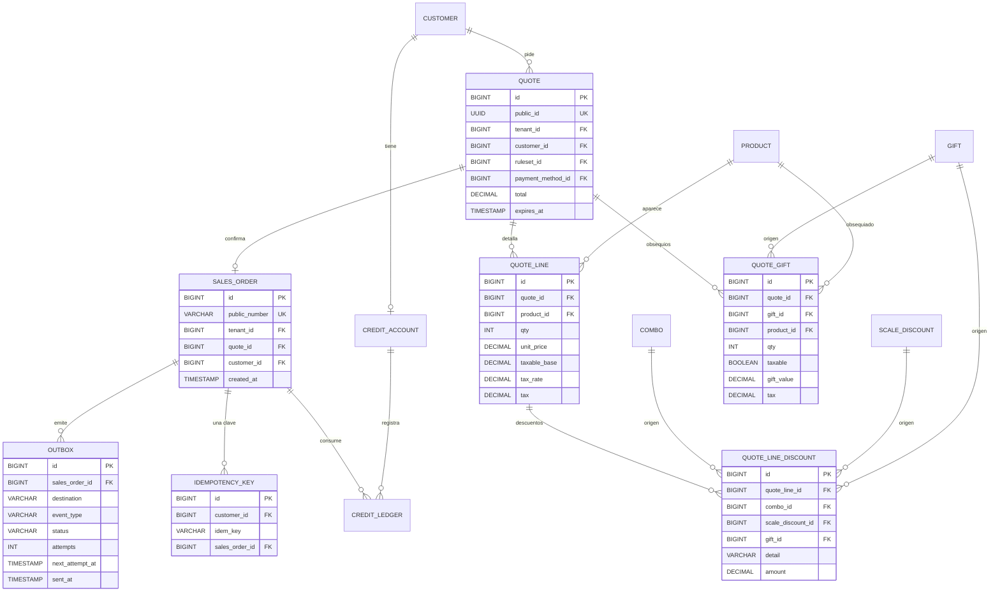

# DER — Entidades principales

Modelo de datos del flujo de pedidos. Se muestran las entidades y columnas clave; las tablas completas están en `src/main/resources/db/migration`.

Las tablas de negocio llevan `tenant_id` y las referencias críticas usan FKs compuestas `(tenant_id, id)`, de modo que una referencia entre marcas es imposible en la base. Los importes son `DECIMAL(19,4)` y las tasas `DECIMAL(7,4)`.

## A.1 Tenancy, impuestos, productos y precios

## A.2 Palancas

## A.3 Cotización, pedido y efectos

Volver al [ADR](https://github.com/diegodob/marketplaceb2b/blob/main/docs/ADR.md).
