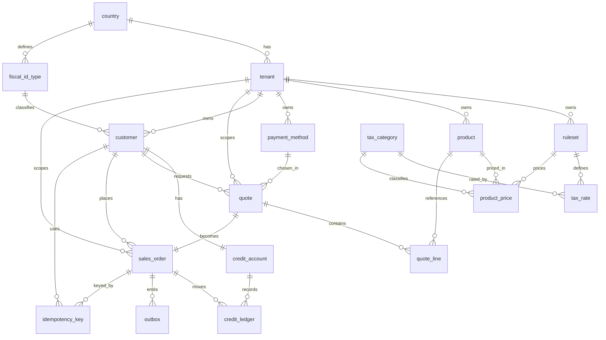

# Design

## Context

The service is a buildable WebFlux skeleton with no persistence (`api-foundation`). This change adds the base relational schema for the order flow. See proposal.md for motivation and `specs/data-model/spec.md` for the behavior contract. The schema must let later changes (scale discounts, combos, gifts) attach through **new migrations only**, without altering existing tables, and must make the hard invariants (identical quoted/confirmed total, exact money, idempotent confirmation, loss-free outbound effects) enforceable by the database.

Stack: Java 21, Spring Boot 3, H2 in-memory in **PostgreSQL compatibility mode**, Flyway migrations.

## Goals / Non-Goals

**Goals:**
- Define every table, key, `UNIQUE`/`CHECK`, foreign key and index for the base model.
- Make each domain invariant traceable to a concrete constraint (see the mapping table below).
- Keep the schema a strict superset of what the pricing/confirmation flows will need, so those land without restructuring.

**Non-Goals:**
- Implementing pricing, quote, confirmation, outbox-relay or HTTP endpoints (separate changes).
- Scales, combos, gifts, discounts.
- Production database tuning, partitioning, or replication.

## Decisions

**Persistence access: JDBC (`JdbcClient`), not JPA.** The model is constraint-driven and insert-only in key tables; an ORM's dirty-checking would fight the append-only design (it could try to `UPDATE` immutable rows). Explicit SQL keeps the constraints and the transactional boundary visible. Alternative considered: JPA/Hibernate — rejected for this model; it adds mapping ceremony we do not need and hides the write path.

**H2 in PostgreSQL mode for tests; Flyway for the schema.** Flyway owns the schema (`db/migration/V*.sql`), so the same migrations run on H2 (test) and on Postgres (production). Migration SQL stays standard; Postgres-specific features are avoided. Alternative: no migration tool (schema from code) — rejected; the take-home asks for migrations and versioned, additive change.

**Migration grouping (one per logical group):** `V1__reference.sql` (`country`, `fiscal_id_type`, `tenant`, `tax_category`, `ruleset`, `tax_rate`), `V2__catalog.sql` (`product`, `product_price`, `payment_method`, `customer`, `credit_account`), `V3__quotes.sql` (`quote`, `quote_line`), `V4__orders.sql` (`sales_order`, `idempotency_key`, `credit_ledger`, `outbox`).

**Identity keys + explicit `UNIQUE`.** Every table uses `id BIGINT GENERATED ALWAYS AS IDENTITY`; every business key is an explicit `UNIQUE`. Public identifiers (`quote.public_id`, `sales_order.public_number`) are `UUID`, never the sequential `id`, so ids are not guessable and do not leak volume.

**Money types.** Money `DECIMAL(19,4)`; tax rates `DECIMAL(7,4)`; Java `BigDecimal`. `ruleset` carries `currency`, `currency_scale` and `rounding_mode`; line-level monetary results are rounded to `currency_scale` with `rounding_mode` before insert. Supported rounding modes are `HALF_UP` and `HALF_EVEN`. The quote total is stored explicitly and equals the sum of already-rounded line values.

**Immutability and append-only enforcement.** The access layer exposes only insert/select for `ruleset`, `quote`, `quote_line` and `credit_ledger`. H2 cannot express SQL-bodied `BEFORE UPDATE`/`BEFORE DELETE` triggers (its `AS $$…$$` form compiles Java source, not SQL), so the guard is the access layer: `PersistenceAccess` rejects any `UPDATE`/`DELETE` statement targeting those tables, and a test verifies the rejection. Database-level triggers are deferred; on PostgreSQL they can be added as a hardened follow-up. This is recorded in Open Questions.

**Foreign-key indexes are explicit.** H2/Postgres do not index foreign keys automatically, so each FK column gets a named index.

**Multi-tenant enforcement.** Shared tables carry `tenant_id`; a single data-access layer always receives the tenant and scopes every query, backed by the two-tenant isolation test. Column-level isolation is not enforceable by the schema alone; this is the documented mitigation. Cross-tenant references (for example a quote pointing at another tenant's payment method or customer) are likewise enforced by the access layer, not by composite foreign keys that would include `tenant_id`.

**Quote validity is configuration, not a constant.** The 24-hour window is read from an application property (e.g. `marketplace.quote.validity`) and written into `quote.expires_at` at quote time.

## Schema detail

`NOT NULL` unless marked nullable. Types are as written for the H2/Postgres migrations.

### V1 — reference

**country**
| column | type | constraints |
|---|---|---|
| id | BIGINT IDENTITY | PK |
| code | VARCHAR(2) | NOT NULL, UNIQUE — ISO code |
| name | VARCHAR(100) | NOT NULL |

**fiscal_id_type**
| column | type | constraints |
|---|---|---|
| id | BIGINT IDENTITY | PK |
| country_id | BIGINT | NOT NULL, FK → country(id), index `ix_fiscal_id_type_country_id` |
| code | VARCHAR(20) | NOT NULL |
| name | VARCHAR(100) | NOT NULL |
| | | UNIQUE (country_id, code) `uq_fiscal_id_type_code` |

**tenant**
| column | type | constraints |
|---|---|---|
| id | BIGINT IDENTITY | PK |
| name | VARCHAR(150) | NOT NULL, UNIQUE |
| country_id | BIGINT | NOT NULL, FK → country(id), index `ix_tenant_country_id` |

**tax_category**
| column | type | constraints |
|---|---|---|
| id | BIGINT IDENTITY | PK |
| code | VARCHAR(30) | NOT NULL, UNIQUE |
| name | VARCHAR(100) | NOT NULL |

**ruleset** (immutable)
| column | type | constraints |
|---|---|---|
| id | BIGINT IDENTITY | PK |
| tenant_id | BIGINT | NOT NULL, FK → tenant(id), index `ix_ruleset_tenant_id` |
| version | VARCHAR(50) | NOT NULL |
| currency | CHAR(3) | NOT NULL |
| currency_scale | SMALLINT | NOT NULL |
| rounding_mode | VARCHAR(10) | NOT NULL |
| effective_from | TIMESTAMP | NOT NULL |
| | | UNIQUE (tenant_id, version) `uq_ruleset_version` |
| | | UNIQUE (tenant_id, effective_from) `uq_ruleset_effective` |

**tax_rate**
| column | type | constraints |
|---|---|---|
| id | BIGINT IDENTITY | PK |
| ruleset_id | BIGINT | NOT NULL, FK → ruleset(id), index `ix_tax_rate_ruleset_id` |
| tax_category_id | BIGINT | NOT NULL, FK → tax_category(id), index `ix_tax_rate_tax_category_id` |
| rate | DECIMAL(7,4) | NOT NULL, CHECK (rate >= 0 AND rate <= 100) |
| | | UNIQUE (ruleset_id, tax_category_id) `uq_tax_rate_category` |

### V2 — catalog and credit

**product**
| column | type | constraints |
|---|---|---|
| id | BIGINT IDENTITY | PK |
| tenant_id | BIGINT | NOT NULL, FK → tenant(id) |
| sku | VARCHAR(60) | NOT NULL |
| name | VARCHAR(200) | NOT NULL |
| family | VARCHAR(80) | NULL |
| | | UNIQUE (tenant_id, sku) `uq_product_sku` (also serves the `tenant_id` FK index) |

**product_price**
| column | type | constraints |
|---|---|---|
| id | BIGINT IDENTITY | PK |
| ruleset_id | BIGINT | NOT NULL, FK → ruleset(id), index `ix_product_price_ruleset_id` |
| product_id | BIGINT | NOT NULL, FK → product(id), index `ix_product_price_product_id` |
| tax_category_id | BIGINT | NOT NULL, FK → tax_category(id), index `ix_product_price_tax_category_id` |
| unit_price | DECIMAL(19,4) | NOT NULL, CHECK (unit_price >= 0) |
| | | UNIQUE (ruleset_id, product_id) `uq_product_price_version` |

**payment_method**
| column | type | constraints |
|---|---|---|
| id | BIGINT IDENTITY | PK |
| tenant_id | BIGINT | NOT NULL, FK → tenant(id) |
| code | VARCHAR(30) | NOT NULL |
| name | VARCHAR(100) | NOT NULL |
| uses_credit | BOOLEAN | NOT NULL |
| | | UNIQUE (tenant_id, code) `uq_payment_method_code` |

**customer**
| column | type | constraints |
|---|---|---|
| id | BIGINT IDENTITY | PK |
| tenant_id | BIGINT | NOT NULL, FK → tenant(id), index `ix_customer_tenant_id` |
| name | VARCHAR(200) | NOT NULL |
| fiscal_id | VARCHAR(30) | NOT NULL — alphanumeric; enforced in Java, no DB `CHECK` |
| fiscal_id_type_id | BIGINT | NOT NULL, FK → fiscal_id_type(id), index `ix_customer_fiscal_id_type_id` |

**credit_account**
| column | type | constraints |
|---|---|---|
| id | BIGINT IDENTITY | PK |
| customer_id | BIGINT | NOT NULL, FK → customer(id), UNIQUE `uq_credit_account_customer` |
| currency | CHAR(3) | NOT NULL |
| credit_limit | DECIMAL(19,4) | NOT NULL |
| available | DECIMAL(19,4) | NOT NULL |
| | | CHECK (available >= 0 AND available <= credit_limit) |

### V3 — quotes

**quote** (immutable)
| column | type | constraints |
|---|---|---|
| id | BIGINT IDENTITY | PK |
| public_id | UUID | NOT NULL, UNIQUE `uq_quote_public_id` |
| tenant_id | BIGINT | NOT NULL, FK → tenant(id), index `ix_quote_tenant_id` |
| customer_id | BIGINT | NOT NULL, FK → customer(id), index `ix_quote_customer_id` |
| ruleset_id | BIGINT | NOT NULL, FK → ruleset(id), index `ix_quote_ruleset_id` |
| payment_method_id | BIGINT | NOT NULL, FK → payment_method(id), index `ix_quote_payment_method_id` |
| total | DECIMAL(19,4) | NOT NULL |
| created_at | TIMESTAMP | NOT NULL |
| expires_at | TIMESTAMP | NOT NULL |

**quote_line** (immutable)
| column | type | constraints |
|---|---|---|
| id | BIGINT IDENTITY | PK |
| quote_id | BIGINT | NOT NULL, FK → quote(id) |
| product_id | BIGINT | NOT NULL, FK → product(id), index `ix_quote_line_product_id` |
| qty | INTEGER | NOT NULL, CHECK (qty > 0) |
| unit_price | DECIMAL(19,4) | NOT NULL — frozen |
| taxable_base | DECIMAL(19,4) | NOT NULL — rounded |
| tax_rate | DECIMAL(7,4) | NOT NULL — frozen |
| tax | DECIMAL(19,4) | NOT NULL — rounded |
| | | UNIQUE (quote_id, product_id) `uq_quote_line_product` (also serves the `quote_id` FK index) |

### V4 — orders, idempotency, ledger, outbox

**sales_order**
| column | type | constraints |
|---|---|---|
| id | BIGINT IDENTITY | PK |
| public_number | VARCHAR(40) | NOT NULL, UNIQUE `uq_sales_order_public_number` |
| tenant_id | BIGINT | NOT NULL, FK → tenant(id), index `ix_sales_order_tenant_id` |
| quote_id | BIGINT | NOT NULL, FK → quote(id), UNIQUE `uq_sales_order_quote` |
| customer_id | BIGINT | NOT NULL, FK → customer(id), index `ix_sales_order_customer_id` |
| created_at | TIMESTAMP | NOT NULL |
| deleted_at | TIMESTAMP | NULL |

**idempotency_key**
| column | type | constraints |
|---|---|---|
| id | BIGINT IDENTITY | PK |
| customer_id | BIGINT | NOT NULL, FK → customer(id) |
| idem_key | VARCHAR(100) | NOT NULL |
| sales_order_id | BIGINT | NOT NULL, FK → sales_order(id), index `ix_idempotency_sales_order_id` |
| | | UNIQUE (customer_id, idem_key) `uq_idempotency_key` (also serves the `customer_id` FK index) |

**credit_ledger** (append-only)
| column | type | constraints |
|---|---|---|
| id | BIGINT IDENTITY | PK |
| credit_account_id | BIGINT | NOT NULL, FK → credit_account(id), index `ix_credit_ledger_account_id` |
| sales_order_id | BIGINT | NOT NULL, FK → sales_order(id) |
| amount | DECIMAL(19,4) | NOT NULL — signed |
| entry_type | VARCHAR(20) | NOT NULL, CHECK (entry_type IN ('CONSUMPTION','REVERSAL')) |
| created_at | TIMESTAMP | NOT NULL |
| | | UNIQUE (sales_order_id, entry_type) `uq_credit_ledger_order_type` (also serves the `sales_order_id` FK index) |

**outbox**
| column | type | constraints |
|---|---|---|
| id | BIGINT IDENTITY | PK |
| sales_order_id | BIGINT | NOT NULL, FK → sales_order(id) |
| destination | VARCHAR(10) | NOT NULL, CHECK (destination IN ('PUSH','ERP')) |
| event_type | VARCHAR(30) | NOT NULL, CHECK (event_type IN ('ORDER_CONFIRMED','ORDER_CANCELLED')) |
| payload | TEXT | NOT NULL — only free-text domain field |
| status | VARCHAR(10) | NOT NULL, CHECK (status IN ('PENDING','SENT','FAILED')) |
| attempts | INTEGER | NOT NULL, DEFAULT 0 |
| next_attempt_at | TIMESTAMP | NULL |
| last_error | TEXT | NULL |
| created_at | TIMESTAMP | NOT NULL |
| sent_at | TIMESTAMP | NULL |
| | | UNIQUE (sales_order_id, destination, event_type) `uq_outbox_event` (also serves the `sales_order_id` FK index) |
| | | index `ix_outbox_relay` (status, next_attempt_at) — operational, for the relay query |

## Constraint → invariant

| Constraint | Invariant protected |
|---|---|
| `country.code`, `tenant.name` UNIQUE | one country/tenant per code/name |
| `fiscal_id_type` UNIQUE (country_id, code) | one fiscal identifier type code per country |
| `ruleset` UNIQUE (tenant_id, version) / (tenant_id, effective_from) | one version in force per tenant, unambiguous |
| `tax_rate` UNIQUE (ruleset_id, tax_category_id) | one rate per category per ruleset version |
| `product` UNIQUE (tenant_id, sku) | catalog is per tenant; no duplicate SKU inside a tenant |
| `product_price` UNIQUE (ruleset_id, product_id) | one net price per product per version (absence = not quotable) |
| `payment_method` UNIQUE (tenant_id, code) | one method per code per tenant |
| `credit_account` UNIQUE (customer_id) + CHECK | one cupo per customer, `0 <= available <= credit_limit` |
| `quote.public_id`, `sales_order.public_number` UNIQUE (UUID) | non-guessable, non-revealing public identifiers |
| `quote_line` UNIQUE (quote_id, product_id) | one line per product per quote |
| `sales_order.quote_id` UNIQUE | a quote originates at most one order |
| `idempotency_key` UNIQUE (customer_id, idem_key) | retries do not duplicate orders |
| `credit_ledger` UNIQUE (sales_order_id, entry_type) | one CONSUMPTION (and one REVERSAL) per order |
| `outbox` UNIQUE (sales_order_id, destination, event_type) | no duplicate effect per order/destination/type |

## Entity-relationship diagram

## Risks / Trade-offs

- **`tax_rate` hangs off a per-tenant `ruleset`** → a country-wide tax change needs a new ruleset version per tenant of that country. Accepted for v1; a shared country-level tax table could be added later.
- **Products are not versioned** → history shows the product's current name, not the name at purchase time. Accepted (the quote line freezes price and rate, not the name).
- **Outbox is not a broker** → it guarantees no loss with at-least-once delivery, but no ordering and no immediacy; in production it would feed Kafka/SQS. Recorded for the ADR.
- **Order history needs a join to `quote`** to show the amount. Accepted; avoids storing a derived total.
- **24-hour quote validity** → the distributor is bound to the price for a day even if rules change, and the credit cupo is **not** reserved at quote time, so the definitive availability check happens at confirmation and can fail even though the quote said it fit. Accepted.
- **Multi-tenant by column** → a forgotten filter could leak rows across tenants. Mitigated by a single tenant-scoped access layer plus the isolation test.
- **H2 vs Postgres dialect drift** → use PostgreSQL compatibility mode and standard SQL; some H2 features (e.g. SQL-bodied triggers) may differ. Validate on Postgres before relying on triggers.

## Migration Plan

- Add H2 + Flyway dependencies and configuration; migrations run on startup.
- Ship `V1`–`V4` as described; the schema is additive, so rollback is "drop and recreate" in dev/test (in-memory H2) and a down migration if ever needed in production.
- Seed data (see tasks) is loaded by a dedicated Flyway migration or a test fixture, never by editing `V1`–`V4`.

## Open Questions

- Immutability/append-only is enforced by the `PersistenceAccess` guard (H2 has no SQL-bodied triggers). Add database-level `BEFORE UPDATE/DELETE` triggers on PostgreSQL to harden it; decide whether to gate them per dialect.
- Should the access layer also enforce tenant scoping generically (every query must carry the tenant), or leave scoping to each repository?
